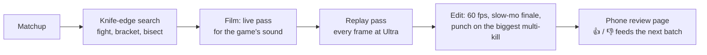
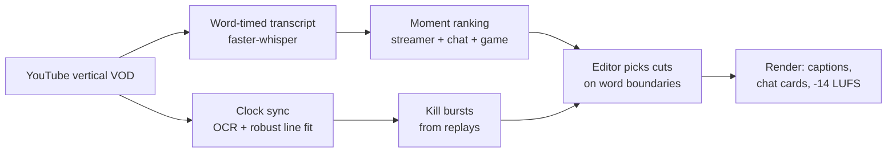

# sc2-shorts-pipeline

How I make StarCraft II YouTube Shorts on a home server, two ways: fights
staged in the real game engine and tuned until they're a coin flip, and
highlights cut from my own stream VODs. This repo is a write-up of both
pipelines plus four pieces of them as working code.

## In production

| | |
|---|---|
| Shorts made | 550 (475 staged in the engine, 75 cut from stream VODs) |
| Fights fought to calibrate | 2,306 across 100 matchups |
| Stream days processed | 9, with 93 games pinned to the VOD by clock sync |
| Fights per calibrated matchup | 6 (median) |
| Stream short render | ~15 s each on CPU |

## Staged fights: "12 zerglings vs 1 Thor: who wins?"



- **The engine is the real game.** The retail client runs headless under Wine
  on the server's GPU, driven through Blizzard's API with python-sc2. Armies
  spawn with debug commands at a measured standoff, so nothing fires early.
- **Knife-edge calibration** ([`knife_edge.py`](shortslab/knife_edge.py)). A
  title is only interesting if you can't call it, so each matchup's count is
  searched in the engine: grow or halve to bracket the edge, bisect, then
  confirm at the edge and one below: six fights per matchup (median). Every fight
  goes to an append-only store, so reruns and upgrades start from evidence.
  At the chosen count the winner typically ends with about a quarter of its HP.
- **Two passes for picture and sound.** SC2 only makes sound in real time, so
  a live pass records the game audio through a PipeWire null sink (a guard
  keeps it off the server's speakers) and saves the replay. A second pass
  steps the replay and renders every frame at Ultra along the live camera.
- **The edit** interpolates to 60 fps with RIFE on the GPU, slows the finale
  and punches in on the largest multi-kill.

## Stream VODs to shorts



- **Moment ranking** ([`moments.py`](shortslab/moments.py)) scores every 5 s
  of a stream from three signals on VOD time: my reactions in the transcript,
  chat 3-25 s later (viewer latency) and replay events like big fights and
  comebacks. Each signal is normalised to its own 95th percentile, and the
  best non-overlapping 30 s windows go to the editor.
- **Clock sync** ([`clocksync.py`](shortslab/clocksync.py)). A replay's save
  time places a game within ~10 s, and the game clock drifts against the VOD
  (rate ~0.98, about a second a minute). So the on-screen clock is read with
  tesseract every 15 s and a line is fitted through the readings, ignoring
  OCR misreads. On a real game it puts 19 of 19 readings on the line.
- **Kill bursts** ([`bursts.py`](shortslab/bursts.py)) find each unit's
  densest 4 s of kills in the replays, mapped onto the VOD through that line:
  the money shots for 30 s unit cuts.
- **The edit** is done by an LLM working from the ranked moments and the
  timed words, then reviewed on my phone. Rendering is ffmpeg: captions one
  to three words at a time, chat messages drawn as cards, and every section's
  start checked by audio cross-correlation.

## Run it

```bash
pip install -e .                    # sc2reader too for bursts: pip install -e .[replays]
python examples/lanchester.py       # the calibration search against a toy fight model
python -m unittest discover -s tests -t .
python -m shortslab.clocksync vod.mp4 3100 336 --crop "crop=110:34:487:480,negate,format=gray"
python -m shortslab.bursts game.SC2Replay --player Name --units "Battlecruiser,Thor"
```

`clocksync` needs ffmpeg and tesseract on the path.

## Not in this repo

The matchup catalog and formats, the editorial rules, the overlays (they use
the game's own art, which isn't mine to publish), the custom maps, the review
page, and the glue that drives the game client.

## License

MIT
